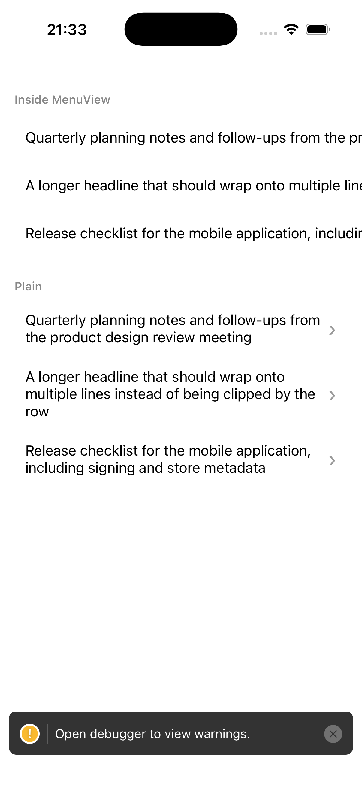
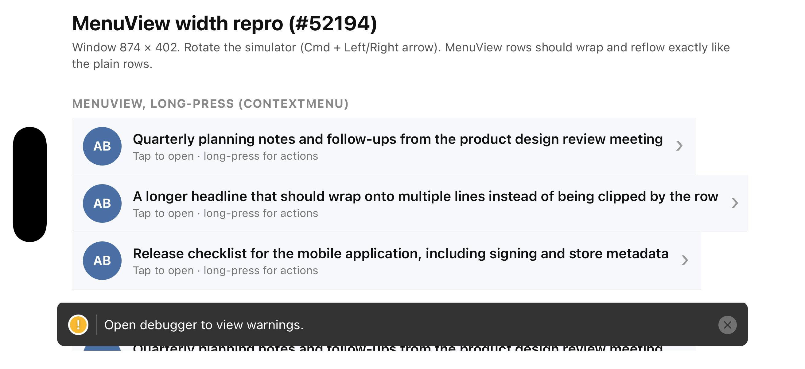
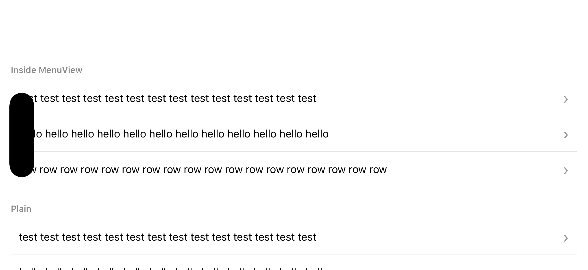
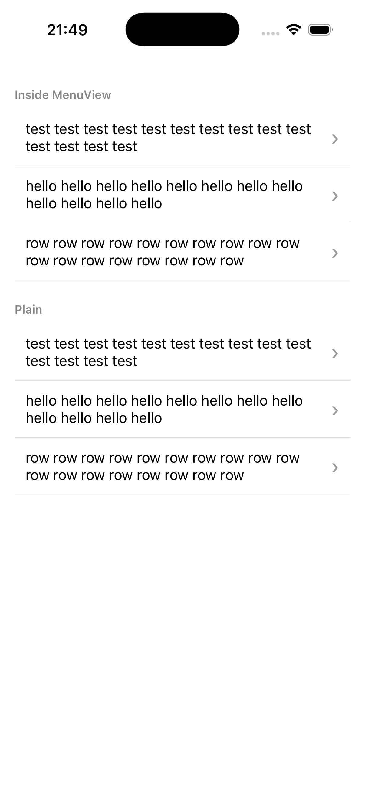

# MenuView width / rotation reproduction (expo/expo#52194)

Reproduces: `@expo/ui` `MenuView` full-width trigger measures unbounded on iOS and keeps its
first size after rotation. Upstream issue: https://github.com/expo/expo/issues/52194
Upstream fix in progress: https://github.com/expo/expo/pull/52205

## Before the fix (iOS 26.5 simulator, iPhone 17, @expo/ui 58.0.23)

| Portrait | Landscape | Portrait again, after rotating back |
| --- | --- | --- |
|  |  |  |

- Portrait: the `MenuView` rows run past the right edge and the chevron is cut off. The plain rows
  wrap.
- Landscape: the window is wider, so the oversized rows happen to fit.
- Portrait again: the `MenuView` rows are clipped again, the plain rows reflowed.

## After the fix

Same app, with the change from the pull request below applied to `@expo/ui` and
`expo-modules-core` in `node_modules` and the Expo modules built from source.

| Portrait | Landscape | Portrait again, after rotating back |
| --- | --- | --- |
|  |  |  |

The `MenuView` rows now match the plain rows in every state: they fill the width, wrap, show the
chevron, and reflow on rotation.

## Status

- Upstream issue: https://github.com/expo/expo/issues/52194
- Fix: https://github.com/expo/expo/pull/52237
- Related, by an Expo contributor: https://github.com/expo/expo/pull/52205

## Run

```bash
npm install
npx expo run:ios          # development build, New Architecture, iOS simulator
```

Rotation is enabled (`orientation: "default"` in app.json). Rotate the simulator with
`Cmd + Left/Right Arrow` (Device menu, Rotate Left / Rotate Right).

## What to look at

The same row is rendered twice: three rows wrapped in `MenuView` (long-press opens the menu),
then the same three rows plain.

## Expected

- Both sets fill the screen width and the long titles wrap. The chevron is visible.
- After rotating to landscape and back, both sets reflow to the new width.

## Actual (SDK 58, @expo/ui 58.0.23)

- The `MenuView` rows are measured with an unbounded width: the title does not wrap, the row is
  wider than the screen and the chevron is cut off.
- After rotating and back, the `MenuView` rows keep the size they had. The plain rows reflow.
- Long-press still opens the menu, so only the trigger layout is affected.

## What it looks like (iOS 26.5 simulator, iPhone 17, @expo/ui 58.0.23)

| Portrait, first layout | Landscape | Portrait again, after rotating back |
| --- | --- | --- |
|  |  |  |

- Portrait: the `MenuView` rows run past the right edge and the chevron is cut off. The plain rows
  wrap.
- Landscape: the window is wider, so the oversized rows happen to fit.
- Portrait again: the `MenuView` rows are clipped again, the plain rows reflowed.

## Status

- Upstream issue: https://github.com/expo/expo/issues/52194
- Fix: https://github.com/expo/expo/pull/52237
- Related, by an Expo contributor: https://github.com/expo/expo/pull/52205

## Run

```bash
npm install
npx expo run:ios          # development build, New Architecture, iOS simulator
```

Rotation is enabled (`orientation: "default"` in app.json). Rotate the simulator with
`Cmd + Left/Right Arrow` (Device menu, Rotate Left / Rotate Right).

## What to look at

The screen shows three groups:

1. **MenuView, long-press** — three full-width rows wrapped in `MenuView` with `shouldOpenOnLongPress`.
2. **MenuView, tap** — one full-width row wrapped in a tap-to-open `MenuView`.
3. **MenuView, small trigger** — a pill-shaped trigger that should hug its content.
4. **Plain React Native** — the same rows without `MenuView`, as the reference.

## Expected

- In portrait, every `MenuView` row is as wide as the plain rows, titles wrap, chevron is visible.
- After rotating to landscape and back, `MenuView` rows reflow like the plain rows.
- The small trigger hugs its content and the text after it sits right next to it.

## Actual (before the fix, SDK 58 / @expo/ui 58.0.23)

- `MenuView` rows are measured with an unbounded width: titles do not wrap, the row is wider
  than the screen, the chevron is pushed off-screen, and the row is clipped at the right edge.
- After rotation the `MenuView` rows keep the size measured before the rotation. Plain rows reflow.
- Long-press and tap still open the menu, so only the trigger layout is affected.
